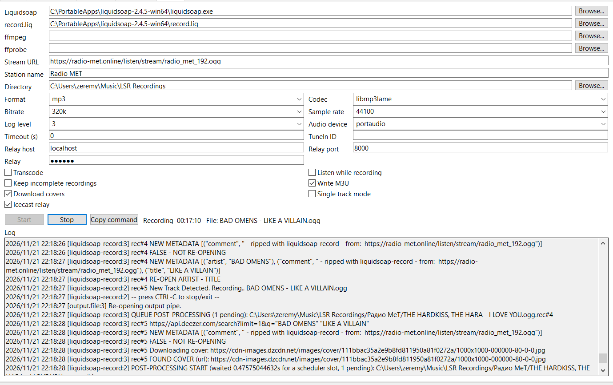

# foo_liquidsoap_record - Liquidsoap Record for foobar2000 (x86 + x64)

Native foobar2000 front-end for https://github.com/smoralis/liquidsoap-record

## Install
- Install foo_liquidsoap_record.fb2k-component
- Put `record.liq` https://github.com/smoralis/liquidsoap-record/blob/main/record.liq next to the dll, or set its path in the window.
- Requires: a liquidsoap executable https://github.com/savonet/liquidsoap/releases#release-v2.4.5 (path set in the window, or on PATH) and ffmpeg/ffprobe https://ffmpeg.org/download.html (paths set in the window, or on PATH).

## Use
- Dockable panel: **Default UI** > Layout > Add panel/element > "Liquidsoap Record";
  **Columns UI** > Preferences > Layout > panel "Liquidsoap Record" (category Panels).
 - All panels and the popup share the same settings and the same running recorder.
- Menu: View > Liquidsoap Record (floating window)
- Right-click an http/https radio track, or a .utag / .tags stub (stream URL from its "@" field, station name from "name") > Record with Liquidsoap... (fills the URL) or
  Record with Liquidsoap (start now).
- Closing the floating window only hides it; recording keeps running. foobar2000 exit stops it gracefully.
- For all parameters usage see  https://github.com/smoralis/liquidsoap-record
 

## Notes
- Settings are stored in foobar2000 config (the relay password is stored in plain text there).
- Only one recording at a time.

## License

MIT License

### Screenshots

